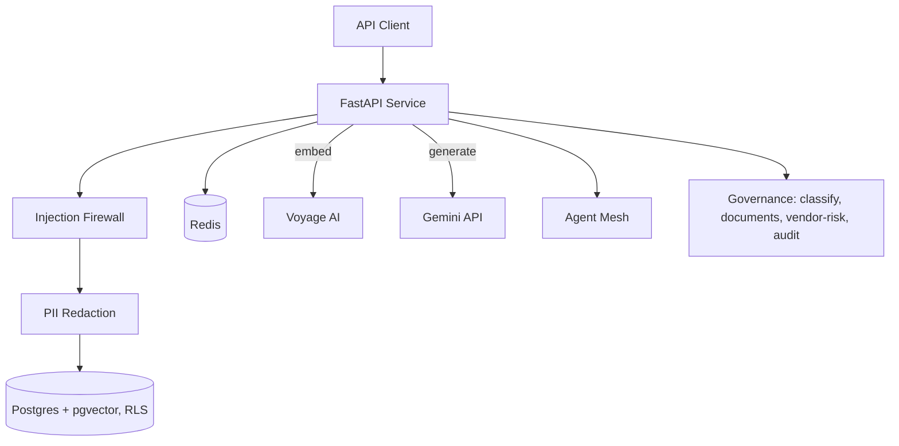

# fazle-enterprise-ai-platform


[](https://github.com/md-fazle-rabbi/fazle-ai-red-team-toolkit/blob/main/proof/report-repo1-after-fix.md)

**A multi-tenant RAG and agent platform built to survive a real security and compliance review: database-enforced tenant isolation, cited answers, a kill switch, and a governance layer.**

## Hire me

**Fazle Rabbi, AI Engineer specializing in secure production AI systems.** Available for freelance engagements and full time roles.
Contact: mfrabbi.ai@gmail.com | LinkedIn: https://www.linkedin.com/in/fazle-rabbi-ai/ | Loom walkthrough (watch without setup): [link]

## At a glance

| Claim | Result | Evidence |
|---|---|---|
| Tenant isolation | Enforced by Postgres Row Level Security, not app code | [`proof/rls-api-isolation.png`](proof/rls-api-isolation.png), [`proof/rls-db-state.png`](proof/rls-db-state.png) |
| Answer quality | RAGAS on 5 golden questions: faithfulness 1.00, answer relevancy 0.86, context precision 1.00. CI gate at 0.90/0.85/0.80 | [`proof/ragas-scores.png`](proof/ragas-scores.png), [`proof/ragas-scores.txt`](proof/ragas-scores.txt) |
| Query latency | p95 3.9 s cold and 1.7 s from the semantic cache, free tier keys, single user, 20 requests each | [`proof/query-latency.txt`](proof/query-latency.txt) |
| Kill switch | Under 5 seconds against a simulated runaway agent loop | [`proof/web-admin-kill-switch.png`](proof/web-admin-kill-switch.png) |
| Audit log | Hash chained, insert only, UPDATE and DELETE change nothing in the database | [`proof/audit-log-tamper-test.txt`](proof/audit-log-tamper-test.txt) |
| HIPAA Safe Harbor coverage | 10 of 18 identifiers detected, gaps named | live `/governance/documents/hipaa-report` |
| Production readiness | 13 areas self assessed, each with its proof and its biggest gap: 10 proven, 2 partly, 1 not done by design | [`docs/production-readiness-scorecard.md`](docs/production-readiness-scorecard.md) |
| Red team run | The 25 probe exploit library of the red-team toolkit, run twice against this stack on one machine with a synthetic tenant. First run: 3 bypassed, all asking for contact details. After the phone number redaction fix (ADR-037): 0 bypassed. One run each and 25 probes, a weak signal. The image suite was not run | [before fix](https://github.com/md-fazle-rabbi/fazle-ai-red-team-toolkit/blob/main/proof/report-repo1-before-fix.md), [after fix](https://github.com/md-fazle-rabbi/fazle-ai-red-team-toolkit/blob/main/proof/report-repo1-after-fix.md) |

*Latency is measured locally for a single user, one request every 21 seconds to stay under the embedding free tier limit, and every request got a 200. See "Observability" for why concurrent p95 isn't published.*

## Read this first
- "SOC2-aligned" means built following SOC2 principles. It is not a SOC2 certification, which needs a third party auditor.
- Nothing here is legal advice. Governance outputs (risk classes, HIPAA and GDPR documents, vendor questionnaires) are drafting aids and coverage checks, not legal determinations.
- Security testing against a live instance needs prior written authorization.
- Every control here reduces risk. None of them, alone or together, removes it.
- The project runs locally by design. See "Run it locally" for why.

## The problem it solves
Two things stop enterprise AI before production: it makes things up with confidence, and it leaks one customer's data into another customer's answer. Legal, security and procurement teams block launches over exactly these two.

This platform handles both at the infrastructure layer, not with prompting tricks. Postgres itself enforces tenant isolation, so no future engineer can bypass it by accident in app code. Every claim in an answer traces to a retrieved, citable source, and CI fails the build if faithfulness drops. A governance layer on top speaks the language procurement and DPO teams use: EU AI Act classification, HIPAA and GDPR documents, and a vendor risk questionnaire.

## What's inside
Four packages behind one API, plus a web app in `apps/web` (sign in with Keycloak, cited chat with saved history, a document list for the signed in tenant and an upload form).

- **rag-engine (trust).** Hybrid search (pgvector plus Postgres full text, RRF fused), enforced citation tags, a CRAG router that grades context before generation, a two layer prompt injection firewall, PII redaction for text, images and PDFs, semantic caching, and a RAGAS gate in CI.
- **agent-mesh (control).** LangGraph agents, RS256 signed agent to agent messages, Keycloak identity, OPA authorization, a two layer code sandbox, and a kill switch measured under 5 seconds.
- **observability (accountability).** End to end traces tied to structured logs, cost and latency dashboards, real load test numbers, exfiltration detection and drift monitoring.
- **governance (compliance).** EU AI Act classification on the post Digital Omnibus timeline, Colorado SB26-189 ADMT assessment, a hash chained audit log, HIPAA Safe Harbor and GDPR RoPA documents, DPIA/DSAR/erasure templates, and a 20 question vendor risk questionnaire.

**Stack:** Python 3.13, FastAPI, PostgreSQL, pgvector, Row Level Security, Redis, LangGraph, Presidio, Keycloak (OAuth2), OPA, OpenTelemetry, Langfuse, RAGAS, Locust, Docker Compose, GitHub Actions, Trivy, CodeQL.
**Frameworks covered:** OWASP LLM Top 10, agentic AI security, EU AI Act, GDPR, HIPAA.

## Architecture


## Run it locally
This runs locally on purpose. Showing the security model honestly needs real infrastructure (Postgres, pgvector, Redis, the API). A stripped down public demo would weaken the very thing it is meant to prove.

```bash
git clone https://github.com/md-fazle-rabbi/fazle-enterprise-ai-platform.git
cd fazle-enterprise-ai-platform
docker compose up --build -d
```
Migrations run automatically before the app starts.

```bash
curl -X POST http://localhost:8000/query \
  -H "Authorization: Bearer fazle-demo-key" \
  -H "Content-Type: application/json" \
  -d '{"question": "How does this system enforce tenant isolation?"}'
```

The same pipeline also streams as Server-Sent Events. It reports each stage as it starts, then sends the checked answer or an error event. It streams progress, not model tokens, because the output checks can rewrite the answer:

```bash
curl -N -X POST http://localhost:8000/query/stream \
  -H "Authorization: Bearer fazle-demo-key" -H "Content-Type: application/json" \
  -d '{"question":"How long do customers have to request a refund?"}'
```

API docs: **http://localhost:8000/docs** once the stack is up. The Loom walkthrough at the top shows the same thing end to end.

**Web app in Docker:** `docker compose up -d --build web` builds the multi-stage, non-root image from `apps/web` and serves it on `http://localhost:3000`, the same address as `npm run dev`. The API does not change.

## Observability
Every `/query` call is traced with OpenTelemetry and exported to Langfuse. Retrieval, CRAG grading, generation and output checks each get their own span with real prompt and response content, not just timings.

- Query p95 latency for a single user is 3.9 s when the answer is built from scratch and 1.7 s when the semantic cache answers it. Each figure is 20 requests on free tier API keys and a small test corpus (three documents of one chunk each), one every 21 seconds, timed with curl, and the p95 of 20 samples is the 19th value, so it is a rough figure ([`proof/query-latency.txt`](proof/query-latency.txt)). The Locust profile in the repo sends one question for every request, so after the first one the cache answers it; an earlier figure of 1.9 s came from that profile, so it most likely measured cached answers, and it is replaced. A trace of one request, with a span for each stage, is in [`proof/langfuse-trace-detail.png`](proof/langfuse-trace-detail.png).
- Concurrent p95 is not published. The embedding provider's free tier caps at 3 requests per minute, so a higher number would measure their limit, not this application.
- The demo API key is limited to 20 requests per hour, shown by a live 429 on request 21 ([`proof/demo-rate-limit.png`](proof/demo-rate-limit.png)).
- Langfuse dashboards are limited to project members on the free tier, so screenshots stand in for a public link.

## Governance and compliance
Built for the teams that actually block AI launches.

| Endpoint | What it does |
|---|---|
| POST /classify | EU AI Act risk tier, current on the post Digital Omnibus deadlines |
| POST /classify/colorado-admt | Colorado SB26-189 automated decision technology assessment |
| POST /governance/documents/hipaa-report | HIPAA Safe Harbor coverage report with honest gaps (10 of 18 identifiers detected today) |
| GET /vendor-risk/questions, POST /vendor-risk/score | 20 question vendor AI risk questionnaire, scored 0-100 as a triage signal, not a pass/fail verdict |
| GET /audit/query, GET /audit/verify | Hash chained, insert only audit log, tamper resistance proven in the database |

DPIA, DSAR and erasure workflows are deliberately not automated by an LLM. A DPIA needs human judgment about proportionality, so these ship as structured templates a qualified person completes.

## Supply chain security
Every dependency surface is pinned, delayed or audited, and the reasoning is recorded in [ADR-028](docs/adr/ADR-028-dependency-update-and-audit-policy.md).

| Control | What it does |
|---|---|
| SHA-pinned GitHub Actions | Each action is pinned to a full commit SHA with a version comment, so a moved tag cannot change what runs. |
| Least-privilege workflows | Permissions default to `contents: read`, and checkout uses `persist-credentials: false`. |
| Pinned toolchain | uv, Python and the runner OS use explicit versions, so CI only changes when a commit changes it. |
| Dependabot with cooldown | npm, GitHub Actions, Docker and docker-compose updates wait 7 days (npm majors 14) before a PR opens, so hijacked or malicious releases are usually caught first. |
| Security updates skip the delay | Cooldown never holds back a CVE fix. |
| Grouped, scheduled PRs | Minor and patch bumps arrive as one PR per ecosystem on a fixed schedule. |
| Production dependency audit | CI runs `npm audit --omit=dev --audit-level=high` and fails on high or critical findings. |

**Limits, stated plainly:**
- Cooldown needs a registry publication date. Docker Hub gives one. quay.io and ghcr.io do not, so Keycloak and the uv image are excluded from Dependabot and bumped by hand after a monthly reminder issue.
- Dependabot's uv job fails on this workspace, so Python advisories rely on `pip-audit` in CI, which does not block the build yet.
- Cooldown is best effort for Docker: if a registry gives no date, Dependabot warns and opens the PR without a delay.

## Proof, not claims

**Isolation and data safety**
- Tenant isolation, at the API and in Postgres directly ([`proof/rls-api-isolation.png`](proof/rls-api-isolation.png), [`proof/rls-db-state.png`](proof/rls-db-state.png))
- Audit log tamper resistance: database level UPDATE and DELETE rules, tested as the owner and as the application role ([`proof/audit-log-tamper-test.txt`](proof/audit-log-tamper-test.txt))
- Chat history isolated per user and tenant by the database, including the fail-closed case ([`proof/backend-conversations-tests.png`](proof/backend-conversations-tests.png))

**Answer quality**
- RAGAS gate: faithfulness 1.00, answer relevancy 0.86 and context precision 1.00 against floors of 0.90, 0.85 and 0.80, enforced in CI ([`proof/ragas-scores.png`](proof/ragas-scores.png), [`proof/ragas-scores.txt`](proof/ragas-scores.txt))

**Agent control**
- Kill switch under 5 seconds against a simulated runaway loop
- Reachable only with a real Keycloak token carrying `platform-admin`, toggled from the web admin view ([`proof/web-admin-kill-switch.png`](proof/web-admin-kill-switch.png))

**Authentication and sessions**
- JWT checks: forged, expired and wrong-audience tokens get 401, and a valid token for a foreign tenant gets 403 ([`proof/web-auth-2-user-jwt-tests.png`](proof/web-auth-2-user-jwt-tests.png), [`proof/web-auth-2-red-team.txt`](proof/web-auth-2-red-team.txt))
- Keycloak tokens carry tenant groups and the rag-engine-api audience, and the web client requires PKCE ([`proof/web-auth-3-alice-access-token.png`](proof/web-auth-3-alice-access-token.png), [`proof/web-auth-3-carol-access-token.png`](proof/web-auth-3-carol-access-token.png))
- Session store: hashed keys, validated reads, and updates that cannot revive a session, tested on real Redis ([`proof/web-session-store-tests.png`](proof/web-session-store-tests.png))
- Login through Keycloak with a Redis session behind an opaque cookie ([`proof/web-login-home.png`](proof/web-login-home.png), [`proof/web-login-redis-session.png`](proof/web-login-redis-session.png), [`proof/web-login-cookie-flags.png`](proof/web-login-cookie-flags.png))
- The API accepts a real Keycloak token from the web app and returns only the signed in tenant's documents ([`proof/web-documents-alice.png`](proof/web-documents-alice.png), [`proof/web-documents-bob-empty.png`](proof/web-documents-bob-empty.png), [`proof/web-token-refresh.txt`](proof/web-token-refresh.txt))

**Web app and chat**
- The scaffold builds cleanly and passes lint, typecheck, format check and all 13 tests ([`proof/web-scaffold-checks.png`](proof/web-scaffold-checks.png))
- Chat is rate limited per user and capped at two simultaneous answers, enforced atomically in Redis ([`proof/web-rate-limit.txt`](proof/web-rate-limit.txt))
- Answers save to the signed in user's history on the server, another user's conversation looks missing, and deleting needs a matching Origin ([`proof/web-history-api.txt`](proof/web-history-api.txt))
- Past chats survive a reload with citations intact and stay private per user and workspace, with an accessibility scan in the end to end test ([`proof/web-history-sidebar.png`](proof/web-history-sidebar.png), [`proof/web-e2e-pass.png`](proof/web-e2e-pass.png))

**Document upload**
- Fourteen cases through the running stack: a text file, an image and a PDF are accepted, a PDF with an injected page is rejected and the page is named, and a missing session, another origin, a wrong type, an empty file and two oversized bodies are each refused with the right status. One upload at a time and the rate limit (ten, then 429 with `Retry-After`) are in the same file ([`proof/web-upload-curl.txt`](proof/web-upload-curl.txt))
- Timing with new files on the free tier: text 5.7 s, an image 3.3 s, PDFs of 5, 10 and 20 pages 19, 39 and 92 s, with no page skipped. The route timeouts come from it ([`proof/web-upload-timing.txt`](proof/web-upload-timing.txt))
- 60 tests for the byte checks and 201 for the route and the form ([`proof/web-upload-validation-tests.txt`](proof/web-upload-validation-tests.txt), [`proof/web-upload-route-tests.txt`](proof/web-upload-route-tests.txt))
- Five browser tests for the form, with axe scans and two screenshots ([`proof/web-upload-e2e.txt`](proof/web-upload-e2e.txt), [`proof/web-upload-success.png`](proof/web-upload-success.png), [`proof/web-upload-refused.png`](proof/web-upload-refused.png))

## End to end testing
Eight Playwright tests in two spec files cover what a user sees: three for sign in, chat and sign out (`login-and-chat.spec.ts`) and five for the document upload form (`upload.spec.ts`).

The main test goes from an anonymous visit to the login redirect, signs in through the real Keycloak, asks a question and sees a cited answer. Then it reloads, reopens that chat from the sidebar and checks the cited answer comes back. An axe accessibility scan runs on the login page, the chat page with an answer, and the sidebar with loaded history.

The second test mocks a stream that ends with no answer and checks the chat shows an error and re-enables Send instead of hanging. It never calls the model.

The third test signs in, clicks Sign out once and expects the login page. It then clicks Sign in and expects Keycloak to ask for a username again, so it checks that the Keycloak session ended and not only the app's own.

The upload tests sign in as alice, upload a new text file and see it listed without a reload, upload the same content again and see it recognised, and see the reason when an `.exe` file is refused. The other three need no real upload: asking for a file first, a mocked rate limit answer, and a mocked slow upload that shows the progress message. An axe scan runs in four of the five. The real ones send three uploads to the real route per run, and the limit is 10 per 10 minutes, so more than three runs in ten minutes will be rate limited. Set `E2E_PROOF_DIR=../../proof` to save the screenshots of both specs; it is off by default, so an ordinary run never rewrites them.

The real uploads leave `e2e-upload` documents in alice's tenant. A later chat answer can then be flagged `low_grounding`, so delete those documents before taking chat screenshots.

All of them need the full stack (`docker compose up -d db redis keycloak app` and `npm run dev` in `apps/web`), alice's tenant already holding the refund-policy document from the `/ingest` example, and alice's Keycloak password in the environment:

```bash
cd apps/web
export E2E_ALICE_PASSWORD="$(grep '^DEMO_USER_PASSWORD=' ../../.env | cut -d= -f2)"
npm run test:e2e
```

## Known limitations
Stated plainly, not left for a client to discover. The four that matter most:

- The only red team testing so far is the toolkit's 25 probe exploit library, run twice against this stack on one machine with a synthetic tenant (3 bypassed, then 0). One run each. The image prompt injection suite, the Keycloak path and a deployed system were not tested.
- The RAGAS gate runs 5 questions over 3 one-chunk documents with a free tier judge model. A pass is evidence on a small set, not a guarantee on a large corpus.
- Latency figures come from one user on one machine, a three document corpus and 20 requests per case. Concurrent p95 is not published.
- This is a local showcase: the `app` container mounts the Docker socket for the sandbox runner, and Keycloak runs in `start-dev` mode.

Full list: [docs/known-limitations.md](docs/known-limitations.md).

## About
Freelance AI Engineer specializing in secure production AI systems. This is one of two flagship projects. The other is a red team toolkit that attacks the controls built here. Its first run found a gap in phone number redaction, fixed in ADR-037.

Contact: mfrabbi.ai@gmail.com | LinkedIn: https://www.linkedin.com/in/fazle-rabbi-ai/

## License
MIT, see LICENSE.md.